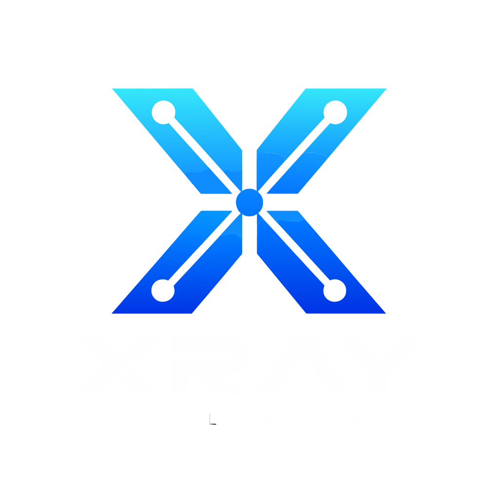

<p align="center">
  
</p>

<h1 align="center">X-ray</h1>
<p align="center">
  <b>Modern, Feature-Rich & Powerful Management Panel for Xray & Multi-Protocol VPN Services</b>
</p>

<p align="center">
  <a href="https://github.com/KAWDHITHA-NIRMAL/x-ray/releases"></a>
  <a href="https://github.com/KAWDHITHA-NIRMAL/x-ray/blob/main/LICENSE"></a>
  <a href="https://x-ray.kawditha.dev"></a>
</p>

---

## 📌 About X-ray

**X-ray** is a modern, high-performance web-based management dashboard developed by **Kawditha Nirmal**. It provides an intuitive user interface to manage Xray-core and multiple proxy protocols with advanced traffic metering, client management, and automated certificate provisioning.

- **Developer:** [Kawditha Nirmal](https://github.com/KAWDHITHA-NIRMAL)
- **Official Website:** [https://x-ray.kawditha.dev](https://x-ray.kawditha.dev)
- **Repository:** [https://github.com/KAWDHITHA-NIRMAL/x-ray](https://github.com/KAWDHITHA-NIRMAL/x-ray)

---

## 🚀 Key Features

* **Multi-Protocol Support:**
  * **VLESS** (XTLS Reality, Vision)
  * **VMess**, **Trojan**, **Shadowsocks**
  * **WireGuard** & **AmneziaWG** (Obfuscated WireGuard)
  * **TUIC v5** & **Telegram MTProto Proxy**
* **User & Client Management:**
  * Client bandwidth limits (total GB) & expiry timestamps
  * IP connection limits (Fail2ban integration)
  * Direct QR Codes & Subscription link generation
* **System & Resource Monitoring:**
  * Real-time CPU, RAM, and Disk telemetry
  * Traffic statistics per client and per inbound
* **Modern React Dashboard:**
  * Clean, fast, and responsive user interface
  * Dark, Light, and Ultra modes
  * Multi-language support
* **Automated Security:**
  * One-click Let's Encrypt SSL via acme.sh
  * 2FA (Two-Factor Authentication / TOTP)
  * Node token encryption

---

## 💻 Quick Installation

### One-line Install Script (Linux)

Run the following command on your Linux server (Ubuntu, Debian, CentOS, AlmaLinux, RockyLinux, Alpine):

```bash
bash <(curl -Ls https://raw.githubusercontent.com/KAWDHITHA-NIRMAL/x-ray/main/install.sh)
```

### Management CLI

After installation, simply type `x-ray` in your terminal to access the management menu:

```bash
x-ray
```


---

## 🐳 Docker Deployment

Run with Docker Compose:

```bash
git clone https://github.com/KAWDHITHA-NIRMAL/x-ray.git
cd x-ray
docker compose up -d
```

The panel will be accessible at: `http://<your-server-ip>:2053/`

* **Default Username:** `admin`
* **Default Password:** `admin`
* **Default Port:** `2053`

---

## 🛠️ Tech Stack

* **Backend:** Go (Golang) + Gin Framework + GORM
* **Frontend:** React 19 + TypeScript + Vite + Ant Design
* **Core:** Xray-core
* **Database:** SQLite (default) / PostgreSQL (optional)

---

## 📄 License

This project is open-source and licensed under the GNU General Public License v3.0 ([GPL-3.0](LICENSE)).

---
<p align="center">
  Developed with ❤️ by <b><a href="https://github.com/KAWDHITHA-NIRMAL">Kawditha Nirmal</a></b>
</p>
